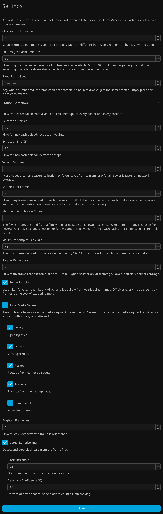
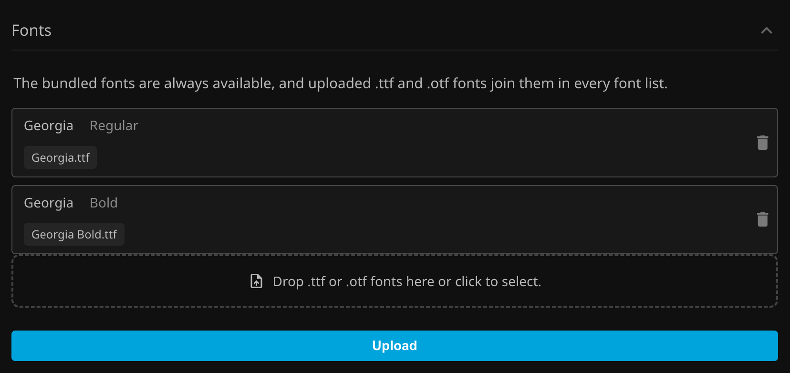
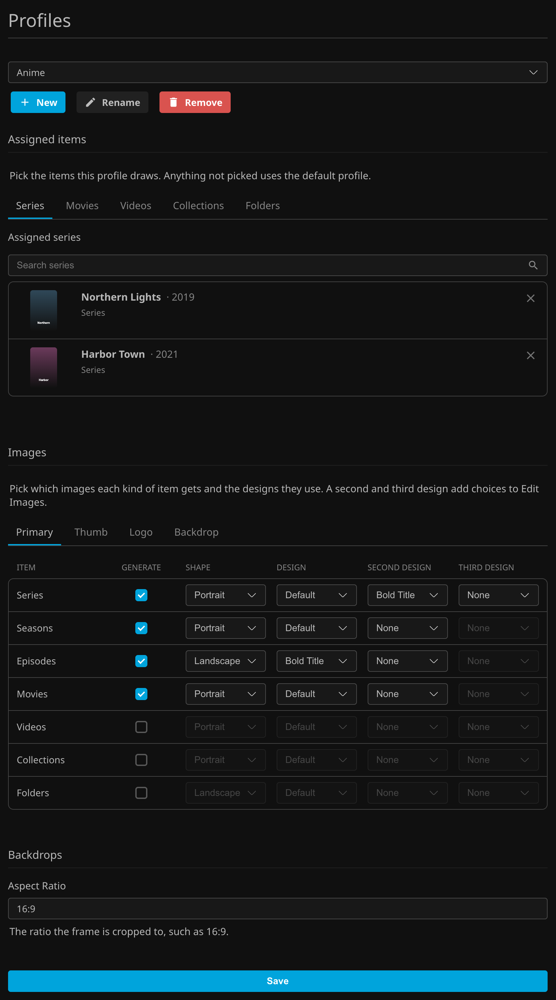
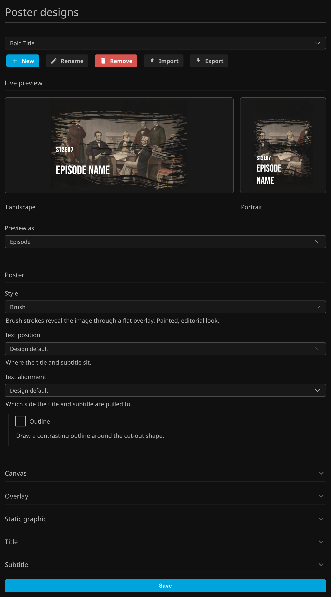
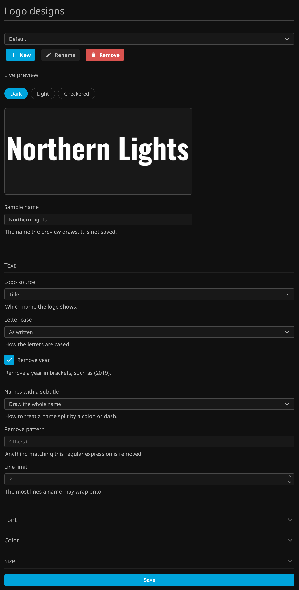

# Artwork Generator Settings

The plugin has four tabs. **Designs** set how a poster looks, **Logos** set how a text logo looks, **Profiles** choose which images are made and which design draws each one, and **Settings** hold the plugin-wide options. Artwork is made for series, seasons, episodes, films, standalone videos such as music videos and home videos, collections, and folders. A whole library is never a target. It keeps the images Jellyfin gives it. Labels below match the configuration pages.

Each tab ends with a full width **Save** bar. While the tab has changes that are not saved, the bar says so, and leaving the tab asks first. After a save it reads "Designs saved.", "Logo designs saved.", "Profiles saved.", or "Settings saved.".

Every color setting is a color picker that stores an ARGB hex value such as #66000000, where the first pair is the opacity. When the color comes from the image instead, under **Palette Colors** or **Color From**, the setting shows only its opacity, as a slider in percent.

## Settings

The Settings tab, with Frame Extraction opened.

* **Choices In Edit Images**: how many choices to offer per image type when replacing an image from the Edit Images dialog, from 1 to 1000. The 1000 is only a safety ceiling against a mistyped value. Each one is rendered from a different frame and costs its own ffmpeg extraction, so higher values make the dialog slower to open. If the previews in the dialog are broken on other devices, set a published server address as described in [Installation](Installation.md#set-a-published-server-uri). An automatic metadata refresh keeps a single image of each type, so it renders only one, and only as many backdrops as the library keeps. A primary image or thumb with a second and third design draws each choice once per design. Rendered choices share a 256 MB memory cache, so a very high value can push the earliest ones out before one is picked. Default 10.
* **Edit Images Cache (minutes)**: how long the choices rendered for the Edit Images dialog stay available, 5 to 1440. Until then, reopening the dialog or switching image type shows the same choices instead of rendering new ones, unless the settings or the item's images have changed. The dialog loads each choice by address, so one picked after this has passed cannot be downloaded and the dialog has to be reopened. They are held in memory, up to 256 MB at once, oldest dropped first, and released as soon as they expire. Default 30.
* **Fixed Frame Seed**: leave empty to pick new frames on every refresh. Any whole number makes frame choice repeatable, so the same item always gets the same frames. Every image of one item, such as a season's poster, thumb, and backdrop, draws from the same shuffled set of frames, each starting at a different place in it. Default empty.

### Frame Extraction

How frames are taken from a video and cleaned up, for every poster and every backdrop.

* **Extraction Start (%)** and **Extraction End (%)**: the stretch of each episode frames are taken from, skipping intros and credits. Default 20 and 80.
* **Videos Per Parent**: the most videos a series, season, collection, or folder takes frames from, 0 to 2000. 0 uses every video. Above 0, they are spread evenly across the whole of it, and a series or season keeps them in episode order. The plugin checks each file is on disk before using it, so a lower number makes generation faster on network storage. Changing it discards the frames already gathered. Default 0.
* **Samples Per Frame**: how many frames are scored for each one kept, 1 to 8. Every sample is its own extraction, so this multiplies the time frame extraction takes. Higher picks better frames. At 1 every frame taken is kept, with no choosing. Default 4.
* **Minimum Samples Per Video**: the fewest frames scored from a film, video, or episode on its own, 1 to 64, so even a single image is chosen from several. It matters most for a refresh, which asks an episode for one to three frames. A series, season, collection, or folder ranks its videos' frames against each other, so each video there takes just **Samples Per Frame** for each frame asked of it. Default 8.
* **Maximum Samples Per Video**: the most frames scored from one video in one go, 1 to 64. It caps a film with many choices. A minimum above it is lowered to it. Default 48.

  Changing any of the three discards the frames already gathered, so the next image uses the new numbers. A configuration from before these settings had a single **Sampling Rate**. Its Low, Medium, or High becomes the numbers it stood for: 2, 4, and 24; 4, 8, and 48; or 8, 16, and 64.
* **Parallel Extractions**: how many frames are extracted at once, 1 to 8, across every video and every item being drawn. A film's samples are taken side by side, and a series, season, collection, or folder works on several episodes at once. Each extraction is still Jellyfin's own, with its HDR handling, and Jellyfin's **Parallel image encoding limit** still applies on top. The frames chosen are the same whatever it is set to, only quicker. Higher is faster on local storage with cores to spare. Lower it, down to 1, if network storage struggles to serve several videos at once. Default 2.
* **Reuse Samples**: lets an item's poster, thumb, backdrop, and logo draw from overlapping frames. With 10 choices, the poster takes frames 1 to 10, the backdrop 2 to 11, the thumb 3 to 12, and the logo 4 to 13, so about 13 frames are extracted. Off, each image type takes its own block, so the poster takes frames 1 to 10, the thumb 11 to 20, the logo 21 to 30, and the backdrop 31 to 40. No two types then share a frame, at the cost of extracting about 40. With it off, a refresh that keeps one image of each type also gives each type a different frame, and fills backdrops to the library's limit after the others, so no backdrop repeats another type's frame. With it on, refresh backdrops beyond the first can share the thumb's and logo's frames. Default on.
* **Avoid Media Segments**: take no frame from inside an item's media segments, with two seconds to spare on either side of each. Segments come from a media segment provider plugin that is turned on for the library, so an item without any is unaffected and only the window above applies. When the segments cover the whole window they are ignored. Default on.
  * **Intros**, **Outros**, **Recaps**, **Previews**, and **Commercials**: the kinds of segment to avoid. Untick one to let frames come from it. Default all on.
* **Brighten Frame (%)**: how much every extracted frame is brightened. Default 0.
* **Detect Letterboxing**: crop black bars off an extracted frame. Default on.
* **Black Threshold**: brightness below which a pixel counts as black. Default 25.
* **Detection Confidence (%)**: percent of pixels that must be black to count as letterboxing. Default 85.

### Fonts

The fonts every design and logo design can use, with an upload for more. **Fonts** sits below the settings' **Save** bar and has an **Upload** bar of its own.

The plugin bundles nine font families, so every server has good fonts even with none installed. They are always available, and they sit inside the plugin's own file, so nothing extra is installed.

| Family | Styles |
| :--- | :--- |
| Anton | Regular |
| Bebas Neue | Regular |
| Lora | Regular, Italic, Bold, Bold Italic |
| Montserrat | Regular, Italic, Bold, Bold Italic |
| Noto Sans | Regular, Italic, Bold, Bold Italic |
| Oswald | Regular, Bold |
| Playfair Display | Regular, Italic, Bold, Bold Italic |
| Poppins | Regular, Italic, Bold, Bold Italic |
| Roboto | Regular, Italic, Bold, Bold Italic |

* **Uploaded fonts**: the list of .ttf and .otf files in the fonts folder, each with its family, its style, and its file name. The family and style come from the font file, not from its name. The delete button removes the file after asking.
* **Upload**: drop or select one or more .ttf or .otf files of up to 20 MB each, then select **Upload**. A file that is not a TrueType or OpenType font, or that the plugin cannot read, is refused with the reason. A file with the same name replaces the one there. After an upload the bar reads "Fonts uploaded."

The fonts folder is `fonts` in the `artworkgenerator` folder under Jellyfin's data path. A font copied there by hand is listed too.

The **Font** lists on **Designs** and **Logos** group the families under **Uploaded**, **Bundled**, and **Server**, and they show a new upload the next time the tab opens. A family name is looked up in that order, so an uploaded font replaces a bundled or installed font of the same name. A style a family lacks uses the nearest one it has. Italic keeps the slant before the weight, and a family with no italic uses its upright face of the nearest weight.

!!! info "Font licenses"
    The bundled fonts come from the [Google Fonts repository](https://github.com/google/fonts) and are licensed under the [SIL Open Font License 1.1](https://openfontlicense.org). Each family's license ships with its files in the plugin.

## Profiles

The Profiles tab, showing a profile with two series assigned and the **Primary** images grid.

* **Profile**: the list at the top picks the profile being viewed and edited. The default profile applies to everything not assigned to another one. It cannot be renamed or removed. **New**, **Rename**, and **Remove** manage the others.
* **Assigned Items**: the items that use the profile, under the tabs **Series**, **Movies**, **Videos**, **Collections**, and **Folders**. Type part of a name in the search box, such as **Search series**, and select a result to add it. Select an item's remove button to take it off. Items another profile holds are left out of the search, since an item belongs to one profile at a time. A profile can carry any mix of them. The default profile has no assigned items.
* **Images**: a tab for each image, **Primary**, **Thumb**, **Logo**, and **Backdrop**, each a grid with one row per kind of item that shows that image. Its columns are **Item**, **Generate**, and the image's design choices. Turn on **Generate** to make the image whenever an item is missing one. The design choices in that row are grayed out until **Generate** is on. Collections and folders are off until ticked. A collection draws its frames from the films and episodes it holds, and a folder from the videos beneath it, so one holding only photos or music gets nothing. A collection or folder uses its readable videos, up to **Videos Per Parent** when that is above 0. One whose frames cannot be extracted, such as a folder of photos, is left with the artwork it has rather than given a blank image. The folders inside music, book, photo, Live TV, and playlist libraries are never drawn, and albums and playlists keep the artwork Jellyfin gives them.
  * **Primary**: the main poster. Choose the **Shape**, Portrait or Landscape, then a **Design**. Series, seasons, movies, videos, and collections default to portrait. Episodes and folders default to landscape. Any design can draw either shape.
  * **Thumb**: a landscape image, offered for every kind. An episode thumb is what many clients show in the next up and resume rows.
  * **Second Design** and **Third Design**: Primary and Thumb can each name up to two more designs, where None means none. The third is grayed out until a second is chosen, and clearing the second moves the third up. They only add choices to the Edit Images picker, where every design draws the same frames and each frame's versions sit side by side. Generating a missing image always uses the first design.
  * **Logo**: a transparent text logo for a series, a film, a video, a collection, or a folder, drawn with the logo design picked under **Design**. The grid notes that Jellyfin clients do not show a logo for seasons or episodes, so it has no rows for them.
  * **Backdrop**: a frame from the video with no design. For an episode it is also saved after its primary image is made, when the episode has no backdrop.
* **Backdrops**: **Aspect Ratio** sets the ratio a backdrop is cropped to, such as 16:9. How its frame is taken from the video is in Settings, under Frame Extraction. Default 16:9.

Jellyfin only asks the plugin for series and season images in libraries where **Artwork Generator** is ticked under Image Fetchers for those item types in the library's settings.

## Designs

The Designs tab, showing a Brush design previewed as an episode.

Every design draws both shapes. The profile decides which one each image uses, so a single design covers a portrait series poster and a landscape thumb without being set up twice. The live preview shows both side by side.

Sizes are a percent of the poster's short side. A portrait image measures them against the average of its two sides instead, so text carries the same weight on a tall poster as it does on a wide one.

* **Design**: the list at the top picks the design being viewed and edited. Profiles pick designs by name. Removing one sends its images to the default design, and drops it wherever it was a second or third design. The default design cannot be renamed or removed.
* **New**, **Rename**, and **Remove**: manage named designs.
* **Import** and **Export**: load a design from JSON as a new design, or save one to JSON.
* **Live Preview**: the design drawn in **Landscape** and **Portrait** against sample artwork. Select a preview to enlarge it. See [Live Preview](Preview.md).
* **Preview As**: what the previews show, **Series**, **Season**, **Episode**, **Movie**, **Video**, **Collection**, or **Folder**.

What a design draws depends on the item. An episode shows its name as the title and a code such as S01E05. A season shows its own name as the title when it has one, and its season, such as SEASON 2 or S02, as the subtitle. A season with no name of its own moves that label up into the title. A series shows only its name, with no season count and no year, since the name is a series' whole identity. Styles built around a number adapt. Cutout punches the series name itself out of the overlay, Numeral draws the name where the numeral would go, and Timeline drops its progress bar.

Split lays out landscape only, so its portrait images are drawn with Standard instead. The Designs page says so under the previews.

## Poster

* **Style**: the layout. Standard, Bloom, Brush, Cutout, Fade, Frame, Frosted Glass, Logo, Numeral, Split, Striped, or Timeline. Default Standard.
  * Timeline draws a season progress bar. It needs the season's episode count, so the bar renders full when the count is unknown, and it does not refresh on its own as more episodes are added to an airing season.
  * Striped draws its sash from the overlay colors. The main band uses **Band Color** and the pinstripes use **Pinstripe Color**.
* **Text Position**: where the title and subtitle sit, Top, Center, or Bottom. Left on Design default, each style keeps the placement it was built around. On Frame it is shown as **Title Edge**. Cutout, Fade, and Striped do not offer it, since their text is part of the artwork rather than a block laid over it. Default Design default.
* **Text Alignment**: which side the title and subtitle are pulled to, Left, Center, or Right. Left on Design default, each style keeps the side it was built around, which is the center for most and the left for Brush and Timeline. Cutout offers it for the title under its lettering, though the lettering itself stays centered. Striped, Fade, and Frame do not offer it, since their text rides a sash, runs sideways up an edge, or is already placed along a border. Default Design default.

### Frame (Style is Frame)

On this design the shared **Text Position** is shown as **Title Edge**, since the two lines take opposite edges rather than sitting together.

* **Title Edge**: which edge of the border the title takes. The subtitle takes the other one. Default top.
* **Lone Subtitle Takes the Title Edge**: an item with no title of its own, such as a season named after nothing but its number, puts its subtitle where the title would go, so an item with one line looks the same whichever line it has. Off, the subtitle keeps its own edge and the title's is left empty. Default on.

### Outline (Style is Cutout or Brush)

* **Outline**: draw a contrasting outline around the cut-out shape, which is the subtitle for Cutout and the brush stroke for Brush. Default on.

### Cutout (Style is Cutout)

* **Type**: what the cutout shows. Code such as S01E05, or Text spelled out. Default Code.

### Logo (Style is Logo)

The logo is the one selected for the item, then its season, then its series. With none, the name is drawn as text instead.

* **Logo Alignment**: horizontal placement. Left, Center, or Right. Default Center.
* **Logo Position**: vertical placement. Top, Center, or Bottom. Default Center.
* **Logo Height**: logo height as a percent of the poster's short side. Default 30.

## Canvas

* **Canvas Background**: the poster's base image. Extract Frame from Video, Grid of Extracted Frames, Use Series Backdrop, or No Background. Seasons and series extract from their own episodes. Default Extract Frame from Video.
* **Grid Frames**: how many frames a grid holds, 2 to 16. They are tiled as evenly as their number allows, and a short last row is centered. Default 4.
* **Grid Gap (%)**: the space between the frames, as a percent of the poster's short side. Default 2.
* **Fill Strategy**: how the canvas fits the poster. Original, Fill, or Fit. Portrait images always crop to fit, since a tall cut of a widescreen frame cannot keep its original shape. Default Original.
* **Landscape Aspect Ratio**: output aspect ratio for landscape images. Default 16:9.
* **Portrait Aspect Ratio**: output aspect ratio for portrait images. Default 2:3.
* **Safe Area**: margin kept clear around all edges. The percent applies to the poster's short side and the same pixel amount is used on all four sides. Default 5.
* **Element Spacing**: gap kept between stacked elements such as the logo, title, and subtitle, as a percent of the poster's short side. Every style resolves its spacing through this one value, so raising it pushes elements further apart everywhere. Default 2.

## Overlay

Most designs wash the overlay across the whole frame, so the gradient and its second color mean what they say. Three shape the overlay themselves and name these settings for what they draw.

* **Palette Colors**: replace the overlay colors with the dominant color sampled from each image. The secondary becomes a darker shade of it. While it is on, **Overlay Color** reads **Overlay Opacity** and **Secondary Overlay Color** reads **Secondary Overlay Opacity**, each a slider in percent, since the image gives the color and only the opacity still applies. Default off.
* **Overlay Color**: the color drawn over the canvas. Bloom calls it **Bloom Color**, Striped calls it **Band Color**, and Fade calls it **Fade Color**. Default #66000000.
* **Overlay Gradient**: the direction the overlay blends in. None, Left to Right, Bottom to Top, Top Left Corner to Bottom Right Corner, or Top Right Corner to Bottom Left Corner. Bloom, Striped, and Fade do not offer it, since each builds its own overlay and has nothing for a direction to act on. Default None.
* **Secondary Overlay Color**: the gradient's far end, shown once a gradient is chosen. Bloom draws it as the **Rim Color** the bloom fades out to and Striped as the **Pinstripe Color** on its sash, so both show it always. Fade draws from one color alone and does not offer it. Default #66000000.

## Static Graphic

* **Graphic File Path**: path to an image drawn above the canvas and below the text.
* **Graphic Position**: vertical placement. Top, Center, or Bottom. Default Center.
* **Graphic Alignment**: horizontal placement. Left, Center, or Right. Default Center.
* **Graphic Size (%)**: size of the graphic as a percent of the poster's short side. The graphic keeps its own proportions inside that size, so it is never stretched. Default 25.

## Title

* **Show Title**: draw the title, which is the item's own name. That is the episode name for an episode, a named season's name for a season, and the series or film name otherwise. Default on.
* **Long Titles**: what to do when a title does not fit. Ellipsis trims it. Abbreviate shortens it in stages. It tries the text before a divider, then the first sentence, then the first letter of every word with periods such as L.O.T.R., keeping dividers and skipping middle initials if still too wide. Drop Name hides it. Default Ellipsis.
* **Use Custom Font**: use a font file instead of a family. Default off.
* **Font Path**: path to the custom font file.
* **Font**: font family for the title, from the uploaded, bundled, and installed fonts in [Fonts](#fonts). Default Montserrat, a bundled font.
* **Font Style**: Normal, Bold, Italic, or Bold Italic. Default Bold.
* **Font Size**: text size as a percent of the poster's short side. Default 10.
* **Font Color**: the title's color. Default #FFFFFFFF.

## Subtitle

* **Show Subtitle**: draw the subtitle, the smaller line beside the title. An episode shows its season and episode, a season shows which season it is, and a series has none. Default on.
* **Hide a Repeated Subtitle**: drop the subtitle when it adds nothing the title has not already said. A season named "Staffel 12" or "Series 12" sits beside a "SEASON 12" label, which is one piece of information written twice. A season with a name of its own, such as "The Glump Saga", keeps both lines, and so does one named "12 Monkeys". A season named plainly "Season 12" never had a second line to drop, since its label is promoted into the title already. Default off.
* **Long Subtitles**: what to do when the subtitle does not fit the width it has, which happens on a narrow portrait poster. Short code says the same thing as S12E07, Shrink to fit keeps the words and sets them smaller, and Ellipsis trims them. Whatever is chosen, the line is squeezed as a last resort rather than allowed over the edge. Default Short code.
* **Use Custom Font**: use a font file instead of a family. Default off.
* **Font Path**: path to the custom font file.
* **Font**: font family for the subtitle, from the uploaded, bundled, and installed fonts in [Fonts](#fonts). Default Montserrat, a bundled font.
* **Font Style**: Normal, Bold, Italic, or Bold Italic. Default Bold.
* **Font Size**: subtitle size as a percent of the poster's short side. Default 7.
* **Font Color**: the subtitle's color. Default #FFFFFFFF.

## Logos

The Logos tab, previewing a sample name.

Logo designs are stored in their own file, `logos.json`, in the plugin's data directory, rather than inside the plugin configuration. Editing a logo therefore never rewrites the rest of your settings.

* **Logo Design**: the list at the top picks the logo design being viewed and edited, with **New**, **Rename**, and **Remove**. At least one must exist.
* **Live Preview**: the logo drawn over a **Dark**, **Light**, or **Checkered** background. Select it to enlarge it. When the color is sampled from the item's artwork, the poster or backdrop it is sampled from shows under it.
* **Sample Name**: the name the preview draws. It is never saved. Left empty, the preview draws the sample series name.

### Text

* **Logo Source**: Title, Original Title, Sort Title, or Folder Name. Falls back to the title when the chosen name is empty. Default Title.
* **Letter Case**: how the letters are cased, whatever case the name arrives in. As written, Uppercase, Lowercase, or Title case. Default As written.
* **Remove Year**: remove a year in brackets such as (2019). Folder names also lose a trailing year and tags like [tvdbid-12345]. Default on.
* **Names With a Subtitle**: how to treat a name split by a colon or spaced dash. Draw the whole name, Title only, Subtitle only, Title large, subtitle small below, or Subtitle large, title small above. The two size layouts read the way a spin-off's own logo usually looks. A name with no colon or dash is always drawn whole. Default Draw the whole name.
* **Small Line Size (%)**: the small line's size as a percent of the large one, in the two size layouts. Default 45.
* **Remove Pattern**: an optional regular expression whose matches are removed. An invalid pattern is ignored.
* **Line Limit**: the most lines a name may wrap onto, 1 to 4. An extra line is only used when it lets the lettering grow noticeably, so a short name stays on one line. Default 2.

### Font

* **Use Custom Font**: use a font file instead of a family. Default off.
* **Font Path**: path to the custom font file.
* **Font**: the typeface, from the uploaded, bundled, and installed fonts in [Fonts](#fonts). Default Montserrat, a bundled font.
* **Font Style**: Normal, Bold, Italic, or Bold Italic. Default Bold.

### Color

* **Letters Filled With**: Color, or Frame from the show. A frame fill cuts the letters out of a picture, taken from the same shared set of frames the show's other images come from, and brightened so it still reads on a dark background. A heavy font shows more of the picture and an outline helps it stand out. With a frame fill, the Edit Images dialog offers several logos, each cut from a different frame. Default Color.
* **Color From**: Chosen Color, or the main color of the item's own Top Level Poster or Top Level Backdrop, lifted to stay legible. Default Chosen Color.
* **Text Color**: the letters' color. With **Color From** set to Top Level Poster or Top Level Backdrop, it reads **Text Opacity**, a slider in percent. The sampled color is then drawn at that opacity, and the chosen color is used only when the artwork cannot be read. Default #FFFFFFFF.
* **Drop Shadow**: a soft shadow under the letters. Default off.
* **Outline**, **Outline Color**, and **Outline Width (%)**: an optional stroke around the letters, its width a percent of the font size. Default off, black, 4.

### Size

* **Width** and **Height**: the room the lettering is laid out in, not the size of the file. The finished logo is trimmed to its own artwork, the way a downloaded clear logo is, so the PNG is usually smaller than this. Default 800 by 310, the common HD clear logo proportions.
