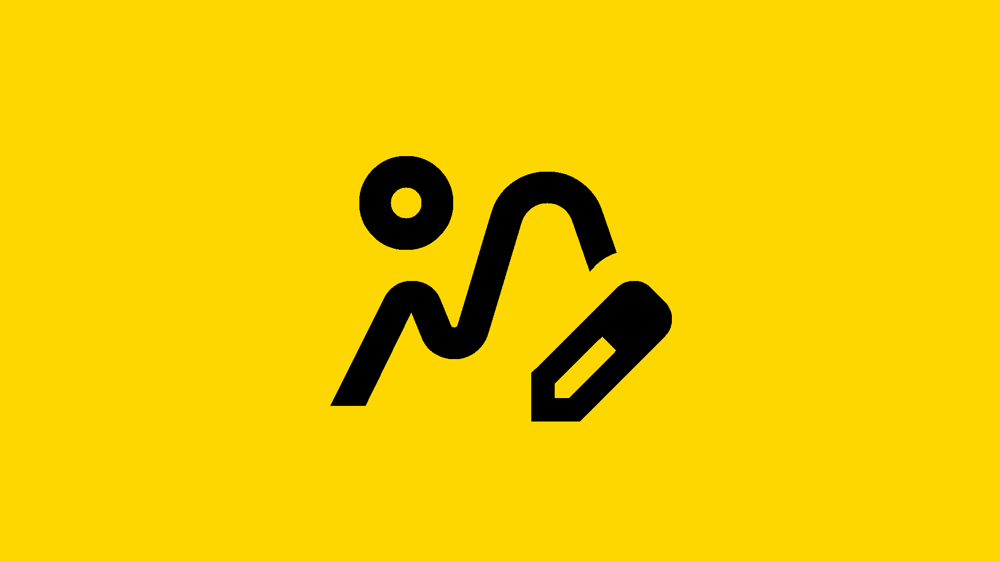

# Artwork Generator

{ width="160" }

Artwork Generator is a Jellyfin plugin that generates artwork for TV shows, films, and standalone videos using smart frame analysis, black frame detection, letterbox detection, and configurable styling. It makes episode posters, portrait series, season, and movie posters, thumbs, backdrops, and text logos, filling in missing or generic artwork with clean, consistent visuals.

## How It Works

Artwork Generator scans video files, evaluates multiple frames, and selects strong candidates while avoiding fades, black screens, and letterboxed shots. The selected frame is turned into an image and optionally styled with configurable text such as a title or numbering. Seasons and series use frames from their own episodes, and a film uses its own video.

Configuration is split into three parts:

* **Designs** set how a poster looks. Each design draws both portrait and landscape, so one design covers a tall series poster and a wide thumb, and the page previews both at once.
* **Logos** set how a text logo looks: which name it uses, how that name is cleaned up, and its font and fill. A name split by a colon or dash can be drawn with either part large and the other small, and the letters can be filled with a frame from the show instead of a color.
* **Profiles** choose which images are made for series, seasons, episodes, films, and standalone videos such as music videos and home videos, and which design draws each. Anything not assigned to a profile uses the default.

Every image of one item draws from a shared set of frames, so a series' poster, thumb, backdrop, and photo logo show different shots from the same pool. A fixed seed in Settings makes frame choice repeatable.

A series poster shows only the show's name. Styles built around an episode number adapt to that: Cutout punches the name itself out of the overlay, and Timeline drops its progress bar.

## Getting a Poster

The plugin runs entirely as a Jellyfin metadata provider. There are two ways to get a poster:

* **Automatically**: a metadata refresh generates any image the item's profile turns on that the item is missing.
* **By hand**: open an item, choose **Edit Images**, and press the search button on an image type. Generated images appear alongside the usual providers, each rendered from a different frame, so you can pick the one you like instead of refreshing until a good frame comes up.

For series, season, and movie images, tick **Artwork Generator** under Image Fetchers for those item types in each library's settings. Jellyfin only asks enabled fetchers for images.

Use Jellyfin's own metadata refresh, on a library or a single item, to generate in bulk. The plugin's one scheduled task, **Cleanup Backdrops** under Library, removes the extra backdrops the plugin generated, leaving each item's first backdrop and any backdrop from elsewhere. It has no schedule until you give it one.

Next: [Installation](Installation.md).
